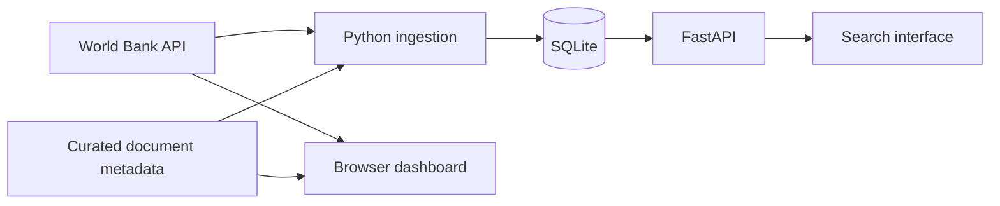

# CivicLens Africa — Public data intelligence case study

Independent Kenya-first research software prototype | Samuel Ndungu Njoroge

## Problem and scope
Public finance documents and macroeconomic series are distributed across institutional websites. CivicLens explores how a searchable source directory and a consistent indicator interface can reduce discovery friction. The implemented scope is Kenya, not a comprehensive African data platform.

## System design



## What has been implemented
| Component | Evidence |
|---|---|
| Document discovery | Six curated document or library records in [catalogue](frontend/documents.json) |
| Economic dashboard | GDP growth, inflation, population, unemployment and GDP per capita |
| Backend ingestion | Three annual World Bank indicators, SQLite persistence and metadata deduplication |
| API | Health, search, overview and series endpoints |
| Quality checks | [Successful test workflow](https://github.com/samuel6183/CivicLens-Africa/actions/runs/45841882234) |
| Deployment | Docker configuration and static Pages workflow; [Pages run failed](https://github.com/samuel6183/CivicLens-Africa/actions/runs/45841882236) |

The five browser indicators use public World Bank data from 2000 onward as available. The browser and backend have different indicator coverage. Publication records are metadata and links, not a verified full-text archive. No measured discovery-time improvement or production adoption is claimed.

## Walkthrough

Install dependencies and run from the repository root:

```bash
pip install -r requirements.txt
python -m backend.ingest documents --file frontend/documents.json
python -m backend.ingest world-bank
python -m uvicorn backend.main:app --reload
```

Open http://127.0.0.1:8000 for the directory, /public.html for the public dashboard, /records.html for records, and /docs for the API. Live retrieval requires network access. Use `python -m unittest discover -s tests -v` and `node --check frontend/public.js` to verify implementation locally.

## Data governance and limitations
Preserve publisher names and source URLs, distinguish missing values from zero, and verify publication links before use. World Bank data may be revised. No automated full-text indexing, AI summaries, procurement feeds or live hosted service is established. Deployment and live-data coverage require further testing. Independent prototype, not government affiliated.

## Research relevance
This is a data infrastructure project rather than a causal economic study. The companion [monetary policy working paper](https://github.com/samuel6183/kenya-monetary-policy-analysis) illustrates how curated national data can support a separate, reproducible empirical analysis.

[Architecture details](docs/architecture.md) · [Engineering reference](docs/engineering-reference.md)
