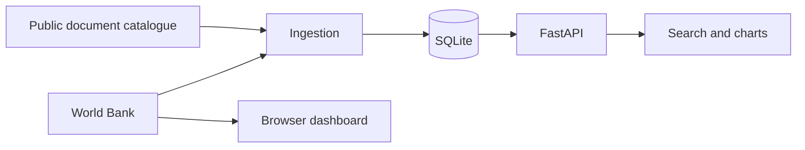

# CivicLens Africa | Public intelligence and economic data

**Kenya-first public-data research prototype**

[Read the complete technical case study](CASE_STUDY.md) · [Source catalogue](frontend/documents.json) · [Architecture](docs/architecture.md)

## Purpose
A searchable public-document directory and economic dashboard designed to make institutional information easier to discover and explore.

| Capability | Implemented scope |
|---|---|
| Public documents | Six curated publication/library records |
| Economic dashboard | Five World Bank indicators |
| Backend ingestion | Three annual indicators |
| Data engineering | Python, SQLite, FastAPI, JavaScript |
| Testing | [Successful automated tests](https://github.com/samuel6183/CivicLens-Africa/actions/runs/45841882234) |
| Public hosting | Not available as a verified deployment |



## Try locally

```bash
pip install -r requirements.txt
python -m backend.ingest documents --file frontend/documents.json
python -m backend.ingest world-bank
python -m uvicorn backend.main:app --reload
```

Open http://127.0.0.1:8000 and select the dashboard or document search. Live data requires network access.

The latest inspected [Pages deployment failed](https://github.com/samuel6183/CivicLens-Africa/actions/runs/45841882236). This is a functioning code prototype with tested components, not a verified live service. Metadata links do not constitute a full-text archive. No invented economic observations are substituted.

[Engineering reference](docs/engineering-reference.md) · [Research portfolio](https://github.com/samuel6183)

## Verification status

[](https://github.com/samuel6183/CivicLens-Africa/actions/workflows/test.yml)

[Latest successful validation inspected on 28 November 2026](https://github.com/samuel6183/CivicLens-Africa/actions/runs/45922757581). This is evidence of automated workflow execution, not independent scientific replication or a verified public deployment.
