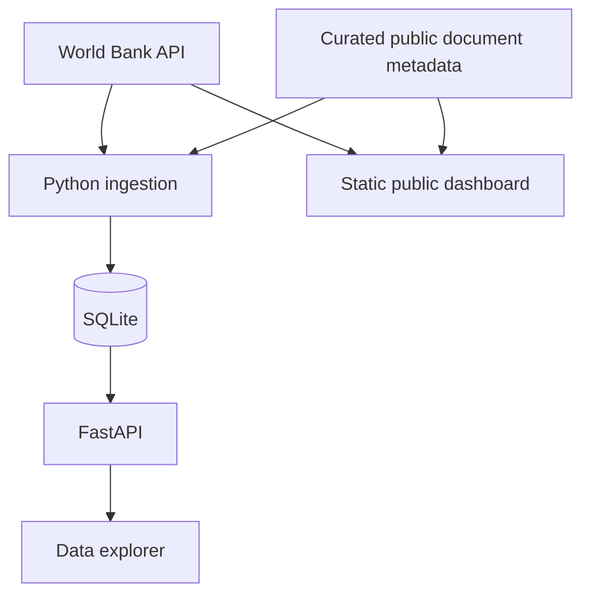

<div align="center">

# CivicLens Africa

### Public Intelligence & Economic Data Analytics

    

**A Kenya-first platform for discovering public documents and exploring economic data.**

[Public dashboard source](frontend/public.html) · [Document catalog](frontend/documents.json) · [Architecture](docs/architecture.md) · [Build history](https://github.com/samuel6183/CivicLens-Africa/actions)

</div>

---

## What this project does

CivicLens Africa brings public institutional information and economic statistics into a single research interface. I built the pilot to explore three practical questions:

> How can researchers locate relevant public documents faster? How can economic data be made easier to explore? How can source provenance be preserved throughout the analytical pipeline?

## Implemented capabilities

| Workstream | Current capability |
| :--- | :--- |
| Public documents | Searchable metadata catalog of six publications or publication libraries |
| Economic intelligence | Five World Bank indicators in the browser dashboard; trend charts, averages, annual changes and CSV export |
| Data engineering | Python ingestion for three annual indicators and curated document metadata; SQLite persistence and duplicate prevention |
| Application engineering | FastAPI read-only endpoints, searchable frontend, automated tests and Docker configuration |

The dashboard requests annual data from 2000 onward, subject to source availability. It does not substitute invented observations for missing data.

## System architecture



## Economic indicators

| Indicator | Measurement |
| :--- | :--- |
| GDP growth | Annual percent |
| Consumer price inflation | Annual percent |
| Population | People |
| Unemployment | Modeled ILO estimate, percent |
| GDP per capita | Current US dollars |

The last two indicators are currently implemented in the browser dashboard only.

## Source coverage

[World Bank](https://data.worldbank.org/country/kenya) · [National Treasury](https://www.treasury.go.ke/) · [KNBS](https://www.knbs.or.ke/) · [Controller of Budget](https://cob.go.ke/) · [CBK](https://www.centralbank.go.ke/) · [Kenya Law](https://new.kenyalaw.org/)

Publication links are curated metadata, not an independently validated full-text archive.

## Repository structure

```text
backend/       API, database and ingestion
frontend/      Dashboard, source directory and catalog
tests/         API and document import tests
docs/          Architecture and limitations
.github/       Testing and publishing workflows
Dockerfile     Container configuration
```

## Getting started

Requires Python 3.10+.

```bash
python -m venv .venv
# Activate the virtual environment for your OS.
pip install -r requirements.txt
python -m backend.ingest documents --file frontend/documents.json
python -m backend.ingest world-bank
python -m uvicorn backend.main:app --reload
```

Open http://127.0.0.1:8000 for the directory, /public.html for the dashboard, /records.html for database search, and /docs for the API reference. Network access is required for live economic data.

## API reference

| Method | Endpoint | Purpose |
| :--- | :--- | :--- |
| GET | /api/health | Database health |
| GET | /api/search | Filter and paginate indexed records |
| GET | /api/overview | Record counts and retrieval status |
| GET | /api/series | Indicator observations |

## Import additional documents

`python -m backend.ingest documents --file your-metadata.json`

Use a JSON array with country (KE), category, title, publisher, HTTPS url, published_date (YYYY-MM-DD or empty) and summary. Verify each source before import.

## Testing and deployment

```bash
python -m unittest discover -s tests -v
node --check frontend/public.js
```

Tests use temporary databases and mocked World Bank responses. GitHub Actions runs the checks. The Pages workflow is configured, but public hosting has not been confirmed successful. Static Pages hosting does not run the Python backend.

```bash
docker build -t civiclens .
docker volume create civiclens-data
docker run --rm -v civiclens-data:/data civiclens python -m backend.ingest world-bank
docker run --rm -p 8000:8000 -v civiclens-data:/data civiclens
```

Use a persistent writable volume and HTTPS in production.

## Roadmap

- [x] Source directory, searchable metadata and read-only API
- [x] Economic dashboard and CSV export
- [x] Automated tests and container configuration
- [ ] Verify public deployment and live data coverage
- [ ] Automated government document ingestion and full-text indexing
- [ ] Public debt and monetary policy analytics
- [ ] Source-backed AI research assistance

## Limitations

Independent research prototype; no government affiliation. No real-time procurement feed, full-text document search, or AI summaries are currently implemented. See [architecture notes](docs/architecture.md).

**Maintainer:** [Samuel Ndungu Njoroge](https://github.com/samuel6183) · [Related monetary policy research](https://github.com/samuel6183/kenya-monetary-policy-analysis)
